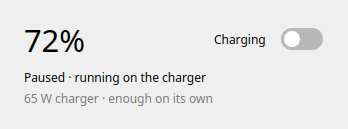

# charge-toggle

Pause battery charging while a Linux laptop runs on its charger.

A laptop that spends its days plugged in keeps its battery full and warm, and that wears a
lithium-ion battery out faster. With charge-toggle you pause charging whenever you like: the
charger powers the laptop and the battery holds its level. Unlike a fixed charge limit, you decide
when.



It works through the kernel's `charge_behaviour` setting, and also tells you whether the charger
can power the laptop on its own. The battery stays connected the whole time: unplug the charger
and the laptop runs on it as usual.

## Install

```sh
pipx install "charge-toggle[gui] @ git+https://github.com/gdianto/charge-toggle"
charge-toggle install-desktop
```

The second command adds Charge Toggle to your application menu. Leave out `[gui]` if you only
want the command line.

## Use

Open Charge Toggle and flip the switch, or use a terminal:

```console
$ charge-toggle status
72% · Charging at 41 W
65 W charger · enough on its own

$ charge-toggle pause
72% · Paused · running on the charger
65 W charger · enough on its own

$ charge-toggle resume
```

Each change asks for your password.

## Compatibility

charge-toggle works on laptops whose firmware lets Linux pause charging. To check yours:

```console
$ cat /sys/class/power_supply/BAT*/charge_behaviour
[auto] inhibit-charge force-discharge
```

If `inhibit-charge` is listed, it works. This is the case on ThinkPads (Linux 5.17 or later) and
on Chromebooks and Framework laptops (Linux 6.12 or later; Framework laptops also need the module
option `cros_charge-control.probe_with_fwk_charge_control=1`). Many other laptops only offer a
fixed charge limit; charge-toggle shows their status but can't pause them.

Windows and macOS have no documented way to do this, so charge-toggle is Linux only.

## How it works

- Pausing writes `inhibit-charge` to each battery's `charge_behaviour` file in
  `/sys/class/power_supply`; resuming writes `auto`. Nothing else is changed.
- Only that write needs root. It runs `tee` through `pkexec`, or `sudo` in a plain terminal.
  Nothing runs in the background.
- If the battery keeps discharging for 10 seconds while the charger is connected, the charger is
  too weak for the current load. The window marks it in amber and sends a notification.
- The firmware has the last word. On ThinkPads, unplugging the charger resumes normal charging,
  and the battery may gain a little while the laptop sleeps.

## Development

```sh
python3 -m venv .venv && .venv/bin/pip install -e ".[gui,dev]"
.venv/bin/ruff check . && .venv/bin/pytest
```

## License

MIT
